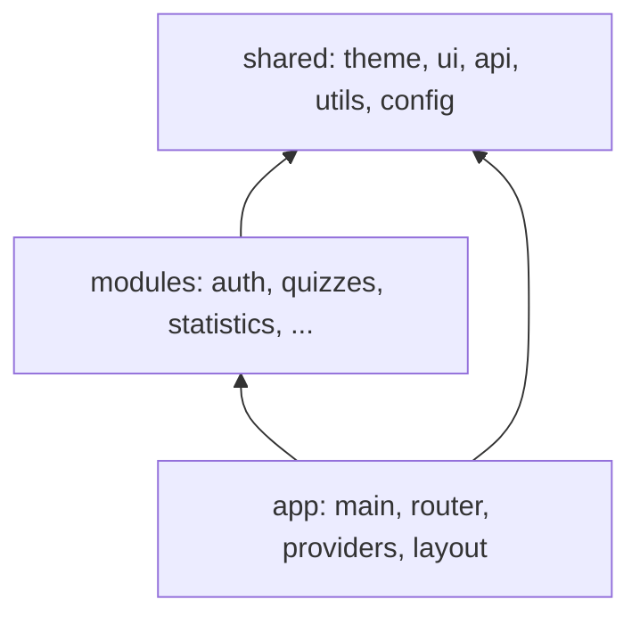

# Decomposition Rules

## Purpose

Features are **vertical slices** under `src/modules/`. Shared code stays small and dependency direction stays one-way. Boundaries are enforced by import paths and review, not by vague “utils” folders.

## R-1. Module owns a capability (MUST)

Each `src/modules/<name>/` slice **SHOULD** contain everything needed for that product area:

| Segment                                              | Role                                                                                                                                            |
| ---------------------------------------------------- | ----------------------------------------------------------------------------------------------------------------------------------------------- |
| `api/`                                               | HTTP + DTO parse for this module                                                                                                                |
| `components/`                                        | Pages and feature UI                                                                                                                            |
| `hooks/`                                             | React Query and feature hooks                                                                                                                   |
| `store/`                                             | Zustand (or similar) when client state is needed                                                                                                |
| `schemas.ts`, `types.ts`, `constants.ts`, `utils.ts` | Domain definitions and pure helpers (`types.ts` holds DTOs and shared aliases — not `XxxProps`; see [02-typescript.md](./02-typescript.md) R-5) |

Domain rules for one feature **MUST NOT** live in `src/utils` unless reused by a second feature.

## R-2. Barrel exports (MUST)

`index.ts` files that re-export sibling modules (“barrels”) are **only** allowed inside:

- `components/`
- `hooks/`
- `utils/`
- `api/`

Examples of **allowed** barrels:

- `src/api/index.ts` — shared HTTP client surface
- `src/components/ui/Button/index.ts` — single primitive

Examples of **forbidden** barrels:

- `src/modules/auth/index.ts` — use `@modules/auth/components/LoginPage`, `@modules/auth/store/sessionStore`, etc.
- `src/config/index.ts` — use `@config/env`
- `src/theme/index.ts` — use `@theme/ThemeProvider`, `@theme/tokens`, etc.

Barrels **MUST** use explicit `export { X } from '...'` — **AVOID** `export *`.

```ts
// Good — direct import
import { useSession } from '@modules/auth/store/sessionStore'

// Bad — module root barrel (removed)
import { useSession } from '@modules/auth'
```

## R-3. Cross-module imports (MUST)

- **MUST** import other modules via **concrete paths** under `@modules/<name>/...`.
- **MUST NOT** import another module’s private internals “for convenience” if those are not part of a stable path (e.g. don’t reach into another module’s `components/` unless importing a named page/component explicitly).

## R-4. One-way dependencies (MUST)



| Layer                                                  | May import                                      | Must not import                                                |
| ------------------------------------------------------ | ----------------------------------------------- | -------------------------------------------------------------- |
| `src/components/ui`, `theme`, `api`, `utils`, `config` | npm packages only                               | `modules`, `layout` (except types if needed — prefer avoiding) |
| `src/modules/*`                                        | shared aliases, other modules’ concrete exports | sibling module “internals” without a clear path                |
| `src/router`, `providers`, `layout`                    | modules + shared                                | —                                                              |

## R-5. Promote to shared only on reuse (SHOULD)

**SHOULD** colocate code with its first consumer. Move to `src/components/ui` or `src/utils` when a **second** module needs it — not before.

## R-6. Component size and SRP (SHOULD)

Split a component when:

- A JSX section repeats or has its own state/data needs
- Container (data) and presentation are mixed in one large file
- A file exceeds ~200 lines without a clear single responsibility
- The file exports more than one component, hook, or util (see [07-solid.md](./07-solid.md))

Example: `statistics/components/charts/*` extracted from `StatisticsPage`.

## R-7. Where logic lives (MUST)

| Concern                        | Location                          |
| ------------------------------ | --------------------------------- |
| Server data                    | `hooks/` + React Query            |
| Pure transforms                | `utils.ts`                        |
| Session / feature client state | `store/` (Zustand)                |
| Form state                     | React Hook Form local to the form |
| URL state                      | TanStack Router search params     |

**MUST NOT** mirror server cache in Zustand.

## R-8. New module checklist (SHOULD)

1. Copy structure from `src/modules/home/` (or `quizzes/` for API-heavy features).
2. Add routes in `src/router.tsx`.
3. Add `tests/` next to code you test.
4. **MUST NOT** add `modules/<name>/index.ts`.

## See also

- [05-architecture.md](./05-architecture.md) — end-to-end data flow
- [03-code-style.md](./03-code-style.md) — barrels and naming
- [07-solid.md](./07-solid.md) — SOLID and one export per file

## References

- [Feature-Sliced Design — Public API](https://feature-sliced.design/docs/reference/public-api)
- [Feature-Sliced Design — Slices and segments](https://feature-sliced.design/docs/reference/slices-segments)
