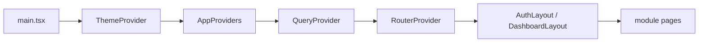
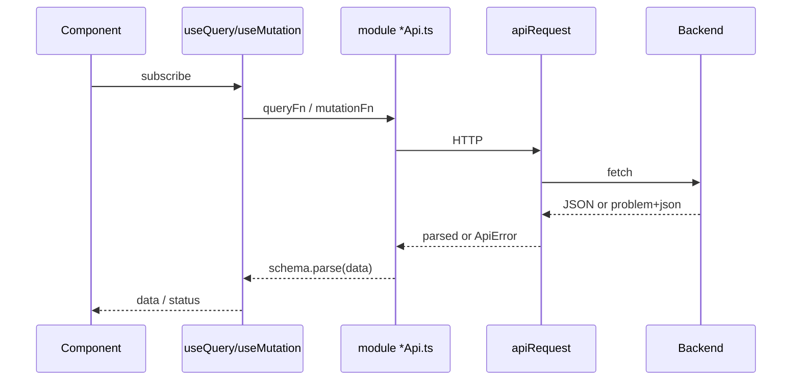

# Architecture and Code Structure

## Purpose

QuizLive.Client is a Vite SPA hosted in `QuizLive.Server/wwwroot`. This doc maps folders, runtime composition, and where each kind of state lives.

## Application bootstrap

- `configureApiClient` runs in `AppProviders` (token + unauthorized handler from auth session store).
- Routes defined in `src/router.tsx` (TanStack Router); path strings **MUST** come from a shared route SSOT — see [08-constants-and-routes.md](./08-constants-and-routes.md). Guards use `readSession()` and `throw redirect(...)`.

## Server data flow

## `src/` layout

| Path | Responsibility |
| --- | --- |
| `main.tsx`, `App.tsx`, `router.tsx` | Entry and routing |
| `providers/` | React Query and app-wide providers |
| `layout/` | Route shells (auth vs dashboard) |
| `modules/` | Feature slices (see [04-decomposition.md](./04-decomposition.md)) |
| `components/ui/` | Design-system primitives |
| `theme/` | vanilla-extract tokens, themes, sprinkles, `ThemeProvider` |
| `api/` | Shared `apiRequest`, `ApiError`, field error helpers |
| `config/env.ts` | Validated `ENV` singleton |
| `utils/` | Cross-feature pure helpers |
| `test/` | Shared test helpers (`renderWithTheme`, `renderApp`, setup) |

Path aliases are defined in `tsconfig.app.json` and resolved by Vite `tsconfigPaths`.

## State ownership

| State | Tool | Example |
| --- | --- | --- |
| Server / remote | TanStack Query | Quizzes list, host stats |
| Auth session | Zustand + persist | `sessionStore` |
| Forms | React Hook Form + Zod | Login, register |
| Ephemeral UI | `useState` | Modal open, tab index |
| Shareable URL | Router search params | Login `redirect` |

## Zustand (session and feature stores)

- **One store per domain** in `modules/<name>/store/`.
- **MUST** select narrow slices: `useStore(s => s.session)` — **AVOID** `useStore()` with no selector.
- Selecting multiple fields as a new object **MUST** use `useShallow` from `zustand/react/shallow` (v5 uses `Object.is`; unstable selectors can loop).
- **SHOULD** derive computed values in selectors instead of storing duplicates.
- Actions live inside the store definition.

## Styling

- **MUST** use vanilla-extract: co-located `Component.css.ts`, tokens from `@theme/tokens` / contract.
- **MUST NOT** add global CSS files outside the theme setup except `index.html` / build assets.
- Use `@components/ui` primitives before inventing new controls.

## Environment and build

- `.env` in `QuizLive.Client/` with `VITE_API_BASE_URL` (see project [README](../README.md)).
- Dev server proxies `/api` to the backend (`vite.config.ts`).
- Production build output: `QuizLive.Server/wwwroot`.

## Realtime (planned)

`@microsoft/signalr` is the designated client for live game/lobby updates. When a realtime module is added, it **SHOULD** own connection lifecycle in `hooks/` or `store/`, not inside presentational components.

## See also

- [01-api.md](./01-api.md) — HTTP and React Query
- [04-decomposition.md](./04-decomposition.md) — modules and barrels

## References

- [TanStack Router](https://tanstack.com/router/latest)
- [Zustand TypeScript guide](https://zustand.docs.pmnd.rs/learn/guides/beginner-typescript)
- [vanilla-extract](https://vanilla-extract.style/)